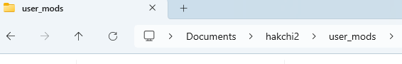
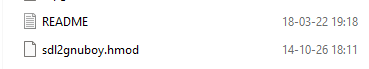
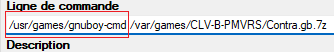

Chocolate Doom installation : 

Chocolate Doom is a Doom source port that is minimalist and historically accurate. This version (3.1.0) has been ported for Nintendo Classic platforms.
In order to run my port you need the modules [libmoduplug](libs/libmoduplug), [libsamplerate](libs/libsamplerate) and [SDL2_mixer](libs/SDL2_mixer).

The modules [Eternln00b-watchdog](Eternln00b-watchdog) and the module [SDL2_rev](libs/SDL2_rev) are also mandatory for this modules. 

The gamepad isn't entirely supported. I had to write a [snippet code](chocolate_doom/src) in order to make it playable with snes controller. 
It should be possible to map your gamepad with my source code. 

The tool "chocolate-doom-setup" is usable but as it's not possible to use a keyboard and a mouse ( according to me ) you can't map your gamepad with it. 
I left it in just in case you have a work around. 

##############################################################################

gnuboy installation : 

In order to use the emulator [gnuboy](https://github.com/Eternln00b/gnuboy), you need to install the module [Eternln00b-watchdog](Eternln00b-watchdog) and the module [SDL2_rev](libs/SDL2_rev).

To install the modules, you have to place them inside a subdirectory of Hakchi2 called "user_mods". 
Most of the time, the root directory of Hakchi2 is located inside "Documents" directory.

=============================================

Once the modules are installed with [Hakchi2](https://github.com/teamshinkansen/hakchi2-ce/releases) you juste have to use the wrapper script "/usr/games/gnuboy-cmd". 
It doesn't require argument. 

This version has been compiled with my SDK with my version of [SDL2 (2.0.14)](https://github.com/Eternln00b/n00b-classic.SDL2/tree/release-2.0.14). 
The emulator runs pretty well and the Nintendo gamepads are directly recognized.
The 8bitdo bluetooth gamepads should work too. I tested it with the [8BitDo Mod Kit](https://shop.8bitdo.com/products/8bitdo-mod-kit-for-original-dogbone-controller) and it worked. 

You can also run boot ROMs. You have to put them ( gb_bios.bin and gbc_bios.bin ) in the folder /etc/libretro/system.

There's no save state mechanism here. However, the sram saves work. 

